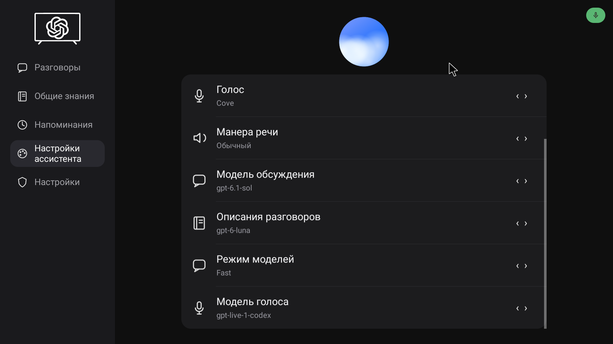
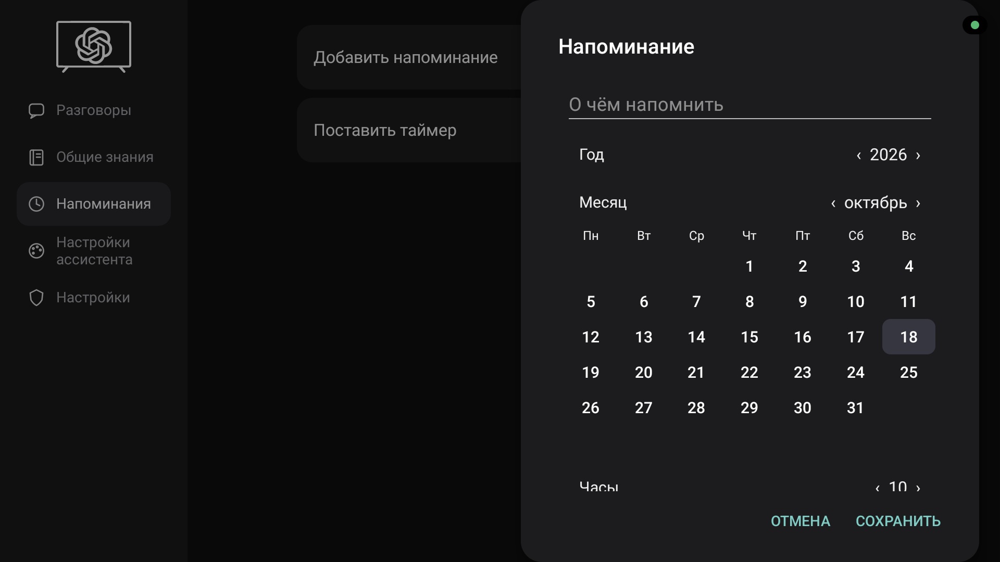

# TV GPT

Голосовой помощник для Android TV: разговаривайте с телевизором, управляйте приложениями и сохраняйте полезное голосом.

Самостоятельное приложение с системным `VoiceInteractionService`, нативным звуком WebRTC и интерфейсом для пульта. Работает непосредственно на телевизоре — компьютер нужен только для разработки и первоначальной настройки.

> Экспериментальный независимый проект. Не является официальным продуктом OpenAI. Текущее целевое устройство — TCL с Android 12 и ARM32; совместимость с другими телевизорами не подтверждена.

## Интерфейс

Голосовой разговор продолжается поверх других приложений — здесь помощник открыт во время просмотра YouTube:

[](docs/screenshots/youtube-live.png)

| Настройки ассистента | Напоминания с пульта |
| --- | --- |
| [](docs/screenshots/assistant-settings.png) | [](docs/screenshots/reminder-editor.png) |

[Все 8 снимков: разговоры, общие знания, напоминания, настройки и таймер](docs/screenshots/README.md). Это реальные кадры с TCL Android TV в исходном разрешении 1920 × 1080. Нажмите на снимок, чтобы открыть его в полном размере.

Ниже показаны кадры предыдущего превью; в текущей сборке также есть раздел «Дайджесты».

## Возможности

- Голосовой разговор через аккаунт ChatGPT: вызов кнопкой ассистента или локальной фразой «Привет, телевизор».
- Отдельное окно разговора — только анимированный шар. Основное приложение содержит настройки, историю, общие знания и напоминания.
- Запуск и поиск в установленных приложениях, навигация пультом, управление громкостью и чтение доступного содержимого экрана.
- Каждый вызов начинает новый разговор. Поиск по прошлым разговорам и общим знаниям выполняется по явной просьбе.
- Новостные дайджесты с источниками, расписанием и заставкой.
- Напоминания и таймеры с редактором для D-pad; при выключенном экране телевизор не должен просыпаться ради напоминания.
- Независимый выбор моделей обсуждения, описаний и Live; доступность зависит от каталога и аккаунта.
- Системное приглушение фоновых приложений во время разговора без изменения общей громкости.

## Сборка и проверка

Нужны JDK 17, Python 3, Node.js/npm и Android SDK: build-tools 35 (`aapt2`, `d8`, `zipalign`, `apksigner`) и Android 35 `android.jar`. Расположение инструментария задаётся через `TVGPT_TOOLCHAIN`; подробности — в [руководстве разработчика](docs/installation-and-development.md).

```sh
npm ci --ignore-scripts
npm run quality
bash scripts/test.sh
bash scripts/build.sh
```

Фирменные звуки не входят в публичные исходники. Личная сборка добавляет их из внешней папки `~/.local/share/tvgpt/private-assets/` (или `TVGPT_PRIVATE_ASSETS`). В публичной сборке звучит собственный короткий двухнотный сигнал; образцы предпрослушивания без локальной папки недоступны. Личная сборка сохраняет прежний стартовый звук, если во внешней папке есть `voice-start.ogg`. Подробности — в руководстве разработчика.

Зависимости закреплены контрольными суммами в [dependencies.json](dependencies.json). APK содержит нативные библиотеки ARMv7 и небольшую русскую модель Vosk. Ключ подписи и результаты сборки хранятся в игнорируемом каталоге `build/`.

## Установка

[Скачать TV GPT 0.1.1-preview для ARMv7](https://github.com/osipovgleb/tvgpt/releases/download/v0.1.1-preview/TV-GPT-0.1.1-preview-armv7.apk) · [Описание релиза и контрольная сумма](https://github.com/osipovgleb/tvgpt/releases/tag/v0.1.1-preview).

Это экспериментальный публичный APK для ARM32. Он содержит собственный стартовый сигнал и не содержит личных голосовых образцов. Публичные сборки подписываются отдельным сохранённым ключом; такая APK не обновляет личную установку с другим ключом подписи.

Прочитайте [руководство по установке и разработке](docs/installation-and-development.md), затем установите собранный APK на своё устройство:

```sh
adb install --no-incremental -r build/tvgpt.apk
```

Откройте TV GPT, разрешите микрофон, войдите в собственный аккаунт по коду устройства, включите службу специальных возможностей и назначьте TV GPT системным помощником. Для действий пульта предусмотрено сопряжение с локальным ADB телевизора. Доступность авторизации и моделей зависит от аккаунта и серверной политики; это собственный клиент подписочного протокола, а не перенос Codex CLI.

На проверенном TCL голосовая служба Google Katniss конкурировала за микрофон. Настройка замены помощника проверяет системные привязки и отключение именно голосового пакета; поведение других прошивок может отличаться. Обратные действия описаны в руководстве.

## Данные и микрофон

При включённом голосовом вызове локальный детектор слушает микрофон на телевизоре. После вызова звук разговора передаётся облачному сервису. Выключите голосовой вызов в настройках, чтобы остановить фоновое прослушивание.

Финальные реплики сохраняются в локальную SQLite; учётные данные защищены AndroidKeyStore. Для управления экраном модель может получать доступный текст и запрошенные снимки. Снимки исключаются из сохраняемого рабочего контекста. Общие знания записываются по явной просьбе пользователя.

## Известные ошибки

Это экспериментальное превью с открытыми проблемами. [Список ошибок, обходных путей и непроверенных сценариев](docs/known-issues.md) обновлён вместе со сборкой.

## Статус

На целевом TCL наблюдались реальная речь, входящие расшифровки, ответы из динамиков и повторные открытия/закрытия. Сборка и тесты на компьютере не подтверждают работу микрофона, standby, эхоотмены или длительную стабильность на другом телевизоре. Экспериментальный подписочный протокол может измениться.

- [Результаты испытаний и их ограничения](docs/native-device-results.md)
- [Архитектура нативного звука](docs/native-performance.md)
- [Контракт интерфейса](docs/ui/interface-contract.md)
- [Технические заметки прототипа](docs/prototype-notes.md)

## Лицензии и сторонние материалы

Уведомления о WebRTC, Vosk, JNA, OkHttp/Okio и использованных материалах протокола находятся в [ресурсах приложения](app/assets/). Лицензия на собственный код проекта пока не выбрана; публичная доступность исходников сама по себе не предоставляет открытую лицензию.

Публичный стартовый сигнал создан процедурно специально для TV GPT; разрешение на использование и воспроизведение из исходного генератора записано рядом с ним. Личная сборка может использовать проприетарный стартовый звук ChatGPT и официальные голосовые образцы. Их происхождение указано в [VOICE_SOUND_SOURCE.txt](app/assets/VOICE_SOUND_SOURCE.txt) и [sources.json](app/assets/voice-samples/sources.json). Разрешение на их публичное распространение в проекте не установлено; эти файлы нельзя считать частью лицензий открытых зависимостей. Эти сторонние аудиофайлы исключены из публичного репозитория; локальная сборка может добавить их из внешней приватной папки. История публичного репозитория начинается с подготовленного снимка исходников; прежняя локальная история не публикуется.
