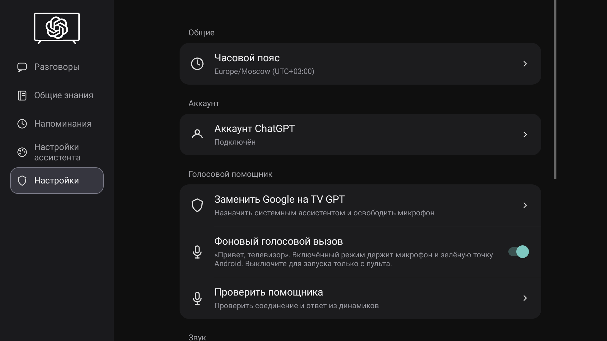
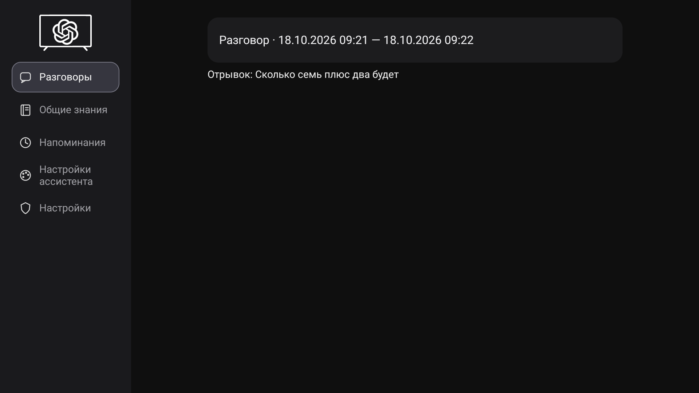
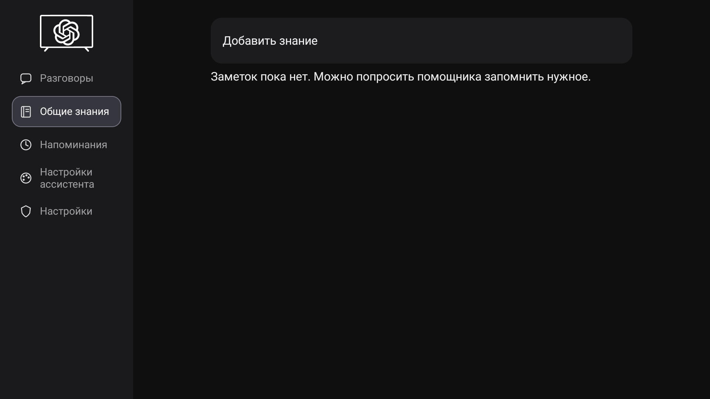
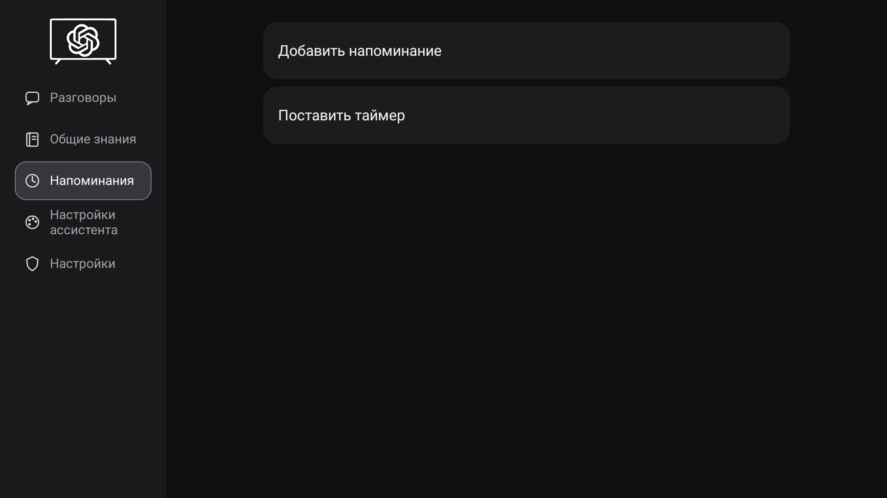
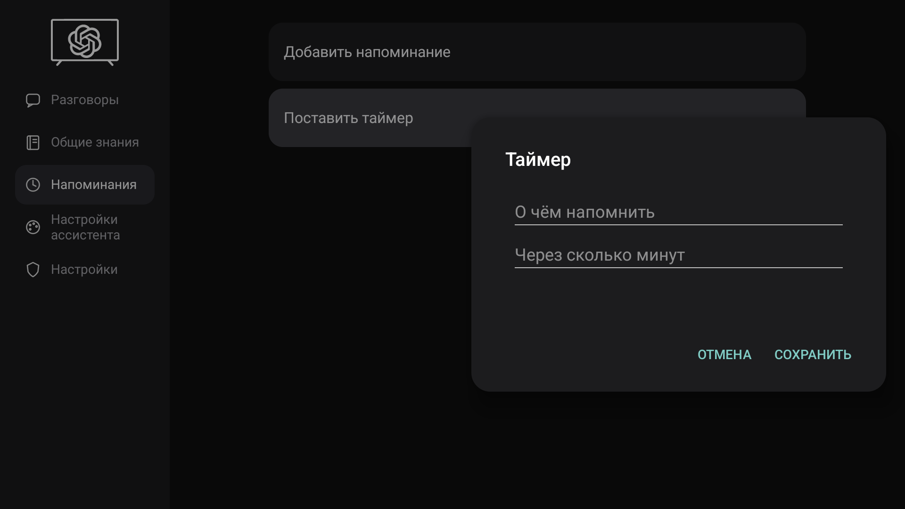

# Галерея TV GPT

Восемь реальных снимков с TCL Android TV, сделанных 18 октября 2026 года. Все кадры — исходные PNG 1920 × 1080 без ретуши и изменения интерфейса. Нажмите на изображение для просмотра в полном размере.

Голосовой разговор был открыт на телевизоре, после чего выполнен переход в YouTube. На кадре виден шарик помощника поверх воспроизводящегося видео. Сам снимок подтверждает отображение интерфейса; он не является записью звука. Видеокадр: «Boeing 757 и 767 | Близнецы, которых нечем заменить», канал airboy123.

При съёмке редакторы открывались без сохранения заметок, таймеров и напоминаний. После съёмки тестовый разговор закрыт, видео поставлено на паузу. Коды входа, адреса аккаунта, аватар и личная переписка в выбранные кадры не попали. В истории виден только арифметический вопрос.

## Голосовой разговор поверх YouTube

## Настройки ассистента

## Общие настройки и подключение

## Разговоры

## Общие знания

## Напоминания

## Календарь и редактор напоминания

## Редактор таймера

